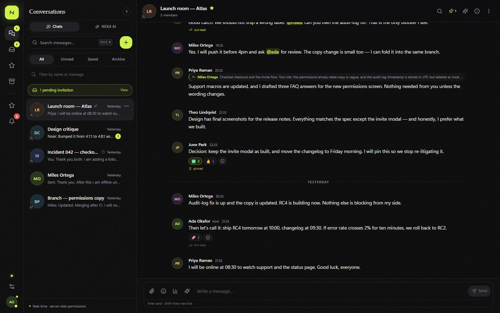
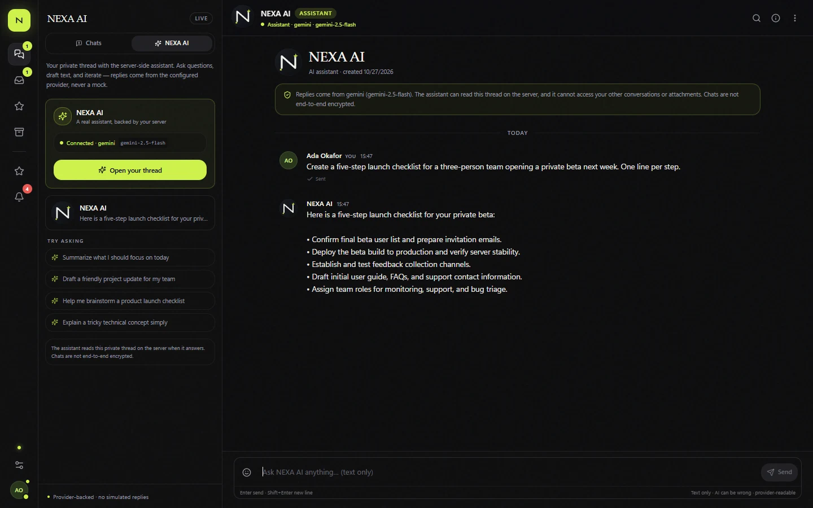
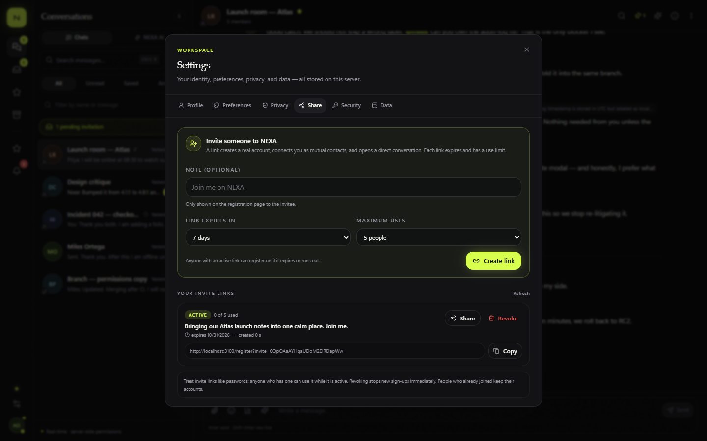
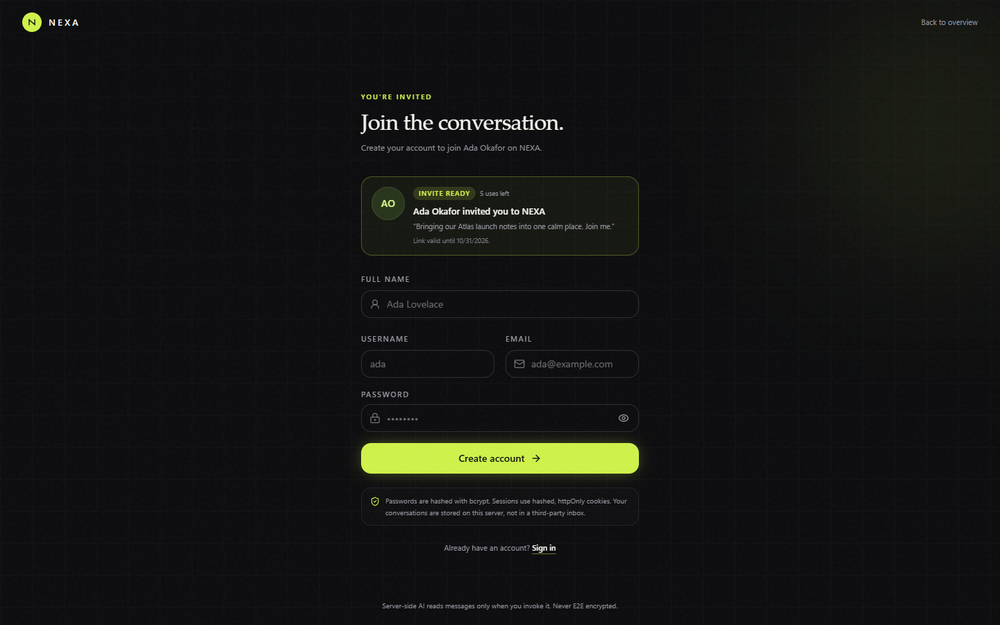
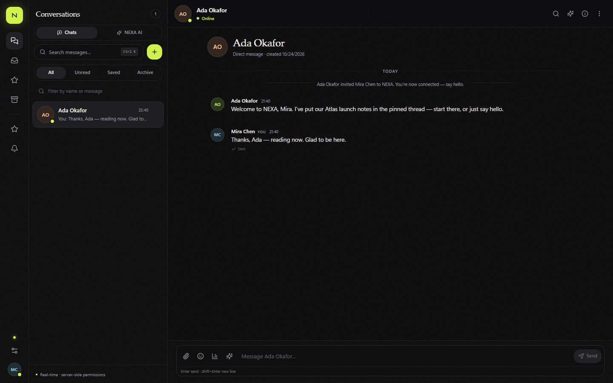
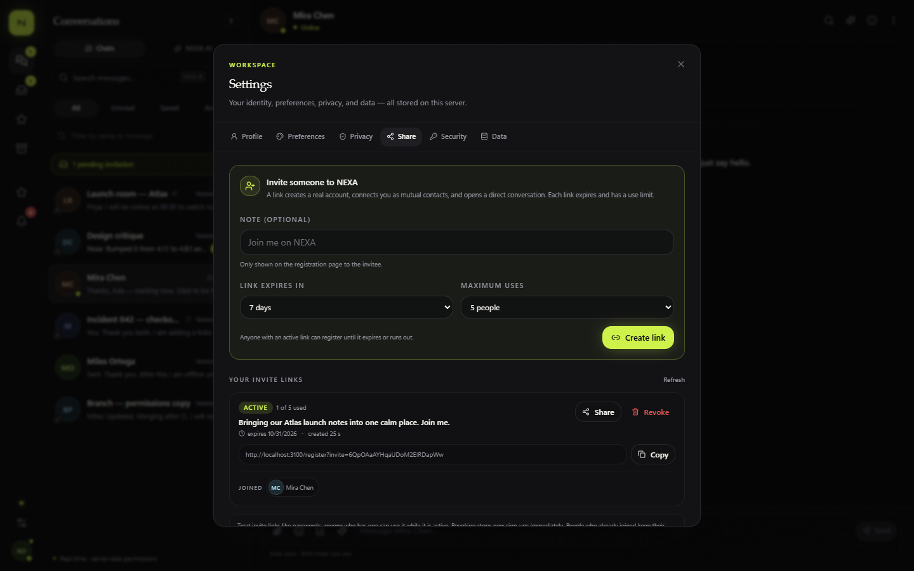
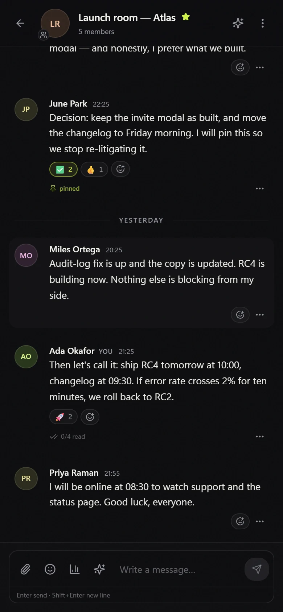
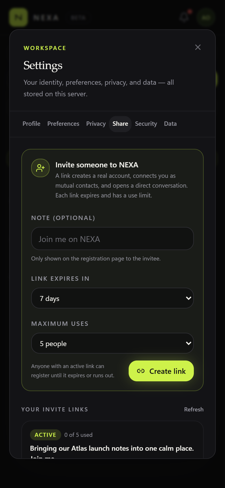
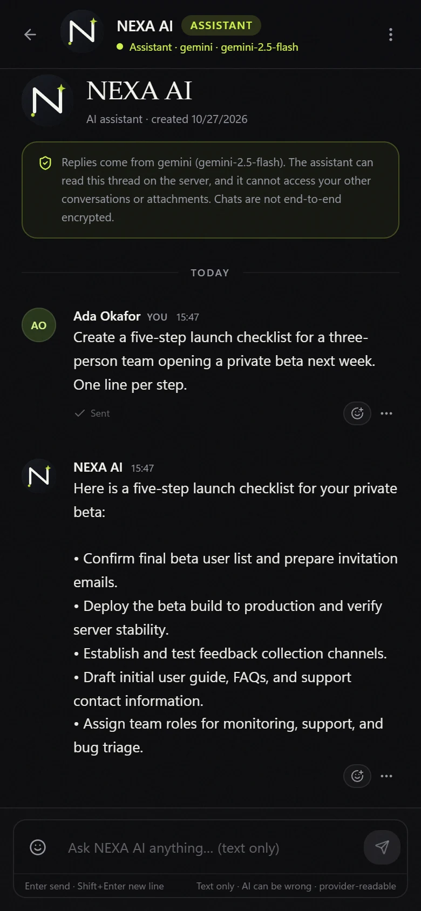

# NEXA

**Every conversation, more intelligent.**

NEXA is a self-hostable messaging workspace built around real accounts, real PostgreSQL data, real Socket.IO delivery, and an optional AI assistant that fails honestly when no provider is configured. It combines direct messages, groups, temporary rooms, threaded branches, polls, files, search, workspace artifacts, invite-based onboarding, and a Gemini-compatible AI chat into one responsive application.

There are no demo-only controls, simulated conversations, hardcoded AI answers, or decorative backend calls. Every visible action is wired to an authorization-checked route or socket event.

> **Privacy honesty:** NEXA is **not** end-to-end encrypted. Messages are encrypted in transit by TLS and stored server-side. The operator, database, and backups can read message bodies. When AI is enabled, the selected content is sent to the configured provider. The standalone AI assistant can read only its own thread; grounded summary/search endpoints read only the conversation they were asked about. See [Security and privacy](#security-and-privacy).

`Next.js 15` · `React 19` · `TypeScript` · `Prisma 6` · `PostgreSQL` · `Socket.IO 4` · `Tailwind CSS 3` · `Gemini / Ollama / OpenAI-compatible`

---

## Screenshots





| App sharing | Invite registration |
| --- | --- |
|  |  |

| Connected through an invite | Invite usage in settings |
| --- | --- |
|  |  |

<p align="center">
  
  &nbsp;&nbsp;&nbsp;
  
  &nbsp;&nbsp;&nbsp;
  
</p>

---

## Contents

- [At a glance](#at-a-glance)
- [What NEXA is](#what-nexa-is)
- [Product surface](#product-surface)
- [Technology stack](#technology-stack)
- [System architecture](#system-architecture)
- [Repository map](#repository-map)
- [Data model](#data-model)
- [Authentication and sessions](#authentication-and-sessions)
- [Conversations and messaging](#conversations-and-messaging)
- [Real-time protocol](#real-time-protocol)
- [NEXA AI](#nexa-ai)
- [App sharing and invites](#app-sharing-and-invites)
- [Attachments and storage](#attachments-and-storage)
- [Search](#search)
- [Frontend architecture](#frontend-architecture)
- [API reference](#api-reference)
- [Configuration](#configuration)
- [Running NEXA](#running-nexa)
- [Testing and QA](#testing-and-qa)
- [Deployment](#deployment)
- [Security and privacy](#security-and-privacy)
- [Limitations and scaling path](#limitations-and-scaling-path)
- [Demo data](#demo-data)
- [Documentation index](#documentation-index)

---

## At a glance

| Dimension | Implementation |
| --- | --- |
| Application model | One Node process serves Next.js App Router, REST route handlers, and Socket.IO on one port |
| Identity | Email/username + password, bcrypt cost 12, opaque session tokens stored only as SHA-256 hashes |
| Conversations | `DIRECT`, `GROUP`, `ROOM` (temporary), and `BRANCH` share one table and one membership model |
| Messaging | Replies, edits, soft deletes, mentions, reactions, pins, bookmarks, forwarding, polls, context cards, receipts, unread counts |
| Realtime | Cookie-authenticated Socket.IO; per-user rooms; typing, presence, receipt, message, conversation, notification, workspace, and AI events |
| AI | `none`, `ollama`, `gemini`, or any OpenAI-compatible endpoint. Standalone assistant thread plus grounded summary, ask, compose, digest, extract, memory, embedding, and transcription features |
| Sharing | Expiring, usage-limited app invite links that atomically create mutual contacts and a direct conversation on registration |
| Files | MIME/extension/signature validation, size cap, private local or S3 storage, range streaming behind membership checks |
| Search | PostgreSQL full-text search, `ILIKE` fallback, optional embeddings for semantic search |
| UI | Responsive Next.js client, Radix primitives, Tailwind tokens, dark/light themes, mobile sheet layouts |
| Tests | Vitest integration suite, live HTTP/WebSocket E2E script, browser QA harness for desktop and mobile |

---

## What NEXA is

NEXA is designed as a small-team messaging product rather than a chat demo. Four rules drive the implementation:

1. **The server is authoritative.** Every route authenticates the session, checks resource membership, validates input with Zod, and only then calls a service. The client never decides whether an action is allowed.
2. **Real-time is a fan-out of committed state.** Services write to PostgreSQL first and emit the same DTO the REST API returns. A user with three tabs sees one consistent stream.
3. **AI is optional and honest.** With no provider, AI endpoints return a structured `503 AI_UNAVAILABLE` and the UI explains what is missing. Nothing is fabricated, queued, or silently replaced with a canned answer.
4. **Sharing is an application feature, not a screenshot.** Invite links carry a real token, have expiry and usage limits, can be revoked, and redeem into actual accounts, contacts, conversations, and notifications.

The application is intentionally deployable as a single container. Socket.IO, the Next.js server, and Prisma all run in the same process; PostgreSQL and optional S3 storage are the only external stateful services.

---

## Product surface

| Area | Capabilities |
| --- | --- |
| **Accounts** | Registration with optional invite token, login by email or username, profile and avatar, password change, session revocation, data export, password-confirmed account deletion |
| **Contacts** | Add/remove contacts, block/unblock users, profile lookup, mutual contact creation through app invites |
| **Direct messages** | Canonical `directKey` dedupe, block checks, read/delivered receipts, unread counts, archive/favorite/mute, custom notification levels |
| **Groups** | Owner/admin/member roles, invitations, join/leave, member removal, ownership transfer, group avatars and descriptions |
| **Rooms** | Temporary conversations with `expiresAt`; access and sending stop when the room expires |
| **Branches** | Side threads bound to a parent conversation and source message, with their own membership and message stream |
| **Messaging** | Text, replies, edits, soft deletes, emoji reactions, mentions, pins, bookmarks, forwarding, polls, link/date/decision context cards |
| **Receipts** | Per-recipient delivered/read timestamps, privacy-aware read-receipt settings, socket and REST paths |
| **Files** | Images, video, audio/voice notes, PDF, text, CSV, Markdown, JSON, DOCX, XLSX, PPTX, ZIP; private streaming with HTTP Range |
| **Search** | Conversation-scoped full-text search, attachment-name matches, optional semantic results, citations for AI answers |
| **Workspace** | Per-conversation tasks, checklists, notes, plans, decisions, dates, links, files, a merged timeline, and export |
| **AI assistant** | A dedicated `NEXA AI` direct thread that answers from its own history, with queued turns, retry, thinking state, and explicit offline behavior |
| **Grounded AI** | Conversation summaries with evidence IDs, ask-with-citations, compose/rewrite, notification digests, workspace extraction, transcription, opt-in memory |
| **App sharing** | Expiring invite links with usage limits, revocation, public preview, registration redemption, mutual contacts and a welcome DM |
| **Notifications** | In-app notification center, read state, per-conversation levels, digest preferences, realtime `notification:new` |
| **Customization** | Dark/light theme, profile, avatar, notification preferences, privacy settings, AI memory controls |
| **Accessibility** | Semantic controls, Radix focus management, visible focus rings, reduced-motion support, responsive mobile layouts |

---

## Technology stack

| Layer | Choice | Notes |
| --- | --- | --- |
| Framework | Next.js `15.5.28` (App Router) | Route handlers run on Node.js runtime; custom server wraps Next |
| UI | React `19.1.10`, TypeScript `5.9.3` (strict) | No client-side router duplication; one app shell |
| Styling | Tailwind CSS `3.4.19`, CSS variables, Radix UI primitives | Light/dark tokens; no component library runtime |
| Icons / feedback | `lucide-react`, `sonner` | Toasts for real API results and failures |
| Data | PostgreSQL 17 (embedded locally), Prisma `6.19.3` | Migrations committed; `prisma migrate deploy` in production |
| Realtime | Socket.IO `4.8.4` server and client | Same HTTP server as Next; cookie-authenticated handshake |
| Validation | Zod `3.25.76` | Every JSON body and key query parameter |
| Auth | `bcryptjs` cost 12, opaque 32-byte tokens | Only SHA-256 token hashes are stored |
| AI | Provider adapter over `/chat/completions` | Ollama, Gemini OpenAI-compatible endpoint, or any OpenAI-compatible base URL |
| Storage | Local disk or S3-compatible (`@aws-sdk/client-s3`) | Private objects streamed through the app |
| Tests | Vitest `3.2.4`, `embedded-postgres`, live E2E script | Separate test database; no mocks for authorization paths |
| Runtime | Node.js 22, `tsx` | Docker image based on `node:22-bookworm-slim` |

---

## System architecture

```text
Browser
  |  HTTPS: cookies, REST, server-rendered pages
  |  WebSocket: Socket.IO (same origin, path /socket.io)
  v
+--------------------------------------------------------------+
| server.ts - one Node HTTP server on PORT                     |
|                                                              |
|  Next.js App Router                  Socket.IO               |
|   - /, /login, /register             - session cookie auth   |
|   - /app/[[...id]]                   - per-user rooms        |
|   - /api/* route handlers            - typing / read /       |
|                                      delivered / presence    |
+----------------------------+---------------------------------+
                             |
              +--------------+---------------+
              |                              |
     +--------v---------+          +---------v----------+
     | Service layer    |          | Storage adapter    |
     | authz + rules    |          | local disk / S3    |
     | transactions     |          +--------------------+
     +--------+---------+
              |
     +--------v---------+          +---------------------+
     | Prisma Client    |--------->| PostgreSQL          |
     +--------+---------+          | FTS + vectors       |
              |                    +---------------------+
     +--------v------------------------------+
     | Optional AI provider                  |
     | Ollama / Gemini / OpenAI-compatible   |
     +---------------------------------------+
```

### Why one process?

Next.js route handlers and Socket.IO need the same session and authorization model. Running them in one process avoids a second service, a shared token bridge, and a separate WebSocket deployment. The trade-off is explicit: horizontal scaling needs sticky sessions and a Socket.IO adapter (for example Redis), and the in-memory rate limiter must move to a shared store.

### Request lifecycle

1. **Transport** - TLS terminates at the reverse proxy or platform edge and forwards to `PORT`.
2. **Route handler** - `requireUser(req)` validates the `nexa_session` cookie, checks the request origin for state-changing methods, applies a fixed-window rate limit, and parses the body with Zod.
3. **Service** - loads data, calls `requireMembership` / `requireAdmin` / `requireOwner`, enforces business rules, and writes in a transaction where multiple rows must agree.
4. **Serialization** - `src/server/serializers.ts` shapes DTOs per viewer: reaction `mine`, per-user unread counts, peer resolution, limited profile fields, and redacted settings.
5. **Real-time fan-out** - services call `emitToUsers` or `emitToConversation` after the commit. If Socket.IO is not initialized (tests or CLI), emission is a no-op.
6. **Response** - success returns the resource or `{ data }` shape expected by the client; failures return `{ error: { code, message, details } }` with the matching HTTP status. Zod failures become `422 VALIDATION_ERROR`.

### Runtime responsibilities

| Component | Responsibility |
| --- | --- |
| `server.ts` | Creates the HTTP server, boots Next, authenticates Socket.IO, tracks presence, fans out typing/receipts |
| `src/app/api/**/route.ts` | Transport concerns: auth, origin, rate limit, Zod, HTTP status |
| `src/server/services/*` | Business rules, authorization, transactions, serialization, realtime emission |
| `src/server/ai/*` | Provider clients, prompts, grounded retrieval, JSON validation |
| `src/server/storage.ts` | Upload validation, local/S3 writes, private reads, range support |
| `src/lib/env.ts` | Startup environment validation and provider configuration status |
| `src/components/nexa/*` | Client state, conversation shell, composer, timeline, settings, AI controls |

---

## Repository map

```text
nexa/
  server.ts                     Custom Next + Socket.IO server
  prisma/
    schema.prisma               Data model
    migrations/                 Applied SQL migrations
    seed.ts                     Fictional demo workspace
  src/
    app/
      (auth)/login|register     Public auth pages
      app/[[...id]]/            Authenticated application shell
      api/                      REST route handlers
    components/
      auth-form.tsx             Login/register, invite preview and token submission
      nexa/                     App shell, store, timeline, composer, settings, AI UI
      ui/                       Radix-based primitives
    lib/
      env.ts                    Zod environment schema and provider status
      schemas.ts                Request schemas
      client/types.ts           Shared client DTO types
    server/
      ai/                       Provider adapter and prompts
      services/                 Auth, conversations, messages, invites, AI, search, workspace, storage
      authorization.ts          Membership/role guards
      http.ts                   Auth, CSRF, rate limit, body parsing, error mapping
      realtime.ts               Socket.IO singleton and user-room emission
      serializers.ts            Viewer-aware DTOs
      session.ts                Cookie/session lifecycle
      storage.ts                Local/S3 attachment adapter
  tests/                        Vitest integration tests
  scripts/                      Embedded PostgreSQL, Docker, E2E helpers
  docs/                         Architecture, security, screenshots
  Dockerfile                    Multi-stage production image
  docker-compose.yml            App + PostgreSQL (+ optional Ollama)
  render.yaml                   Render Blueprint
```

---

## Data model

The full schema is in [`prisma/schema.prisma`](prisma/schema.prisma). The important modeling decisions are:

| Model | Role |
| --- | --- |
| `User` | Identity, profile, `isBot` flag, last-seen timestamp; bots are excluded from login, search, and discoverability |
| `UserSettings` | Theme, notification and privacy preferences, read-receipt behavior, AI opt-ins |
| `Session` | Hashed opaque token, expiry, user agent, IP; revocable individually or by password change |
| `Contact` | Directed contact edge; app-invite redemption creates both directions |
| `AppInvite` | Application invite token, note, `maxUses`, `usedCount`, `expiresAt`, `revokedAt` |
| `AppInviteRedemption` | Unique `(inviteId, userId)` proof of redemption; supports idempotent reuse |
| `Block` | Directed block edge; blocks prevent direct messages in either direction |
| `Conversation` | One table for `DIRECT`, `GROUP`, `ROOM`, `BRANCH`; `directKey` dedupes DMs |
| `ConversationMember` | Role, join time, read/delivery watermarks, archive/favorite/mute, notification level |
| `Message` | Body, type, reply/forward links, edit/delete timestamps, `clientId` idempotency, `aiSourceMessageId` |
| `MessageReceipt` | Per-recipient delivered/read timestamps |
| `Attachment` | Private storage key, MIME/kind/size/dimensions, optional message link |
| `Reaction`, `Bookmark`, `ConversationPin`, `Poll*`, `MessageMention` | Engagement and structured message extensions |
| `MessageContext` | Link/date/decision cards attached to a message |
| `GroupInvite` | Conversation/group invite token; distinct from an application invite |
| `Notification` | In-app notification with read state, actor, conversation link |
| `Workspace` / `WorkspaceItem` | Tasks, checklists, notes, plans, decisions scoped to a conversation |
| `Branch` | Side thread bound to a conversation and source message |
| `AiSummary` / `AiEvidence` | Stored grounded summary plus the exact messages cited |
| `PersonalMemory` | Opt-in, per-user notes used only in that user's AI prompts |
| `MessageEmbedding` | Optional vectors for semantic search |

### Invariants

- A direct conversation has a canonical `directKey` derived from the two user IDs, so repeated "message this person" actions reuse the same thread.
- `Message.clientId` is unique per sender/conversation path; a retried send returns the existing message instead of duplicating it.
- `Message.aiSourceMessageId` is unique, so one user message can produce at most one assistant reply even under concurrent scheduling.
- `AppInvite.token` is unique; `AppInviteRedemption` is unique on `(inviteId, userId)`.
- Deleting a user cascades sessions, memberships, messages, reactions, bookmarks, and owned uploads. Conversation creators use `SetNull` so groups survive; ownership is transferred in the service layer.
- Direct conversations are removed for both participants during account deletion.
- Soft-deleted messages keep a tombstone row so replies, audit context, and unread calculations do not break.

---

## Authentication and sessions

### Registration

- Email is normalized to lowercase; usernames are normalized and reserved names (`nexa_ai`, route-like values) are rejected.
- Passwords require length and character-class checks and are hashed with bcrypt cost 12.
- Registration accepts an optional `inviteToken`. The account is created first; redemption is attempted afterward.
- An invalid, expired, revoked, or exhausted app invite does **not** block account creation. The response returns `accepted: false` with a reason; the client signs the person in, redirects to the workspace, and shows a one-time warning that the connection was not created.
- A successful redemption creates mutual contacts, a direct conversation, a system welcome message, a notification for the inviter, and increments the invite usage count atomically. The client opens `/app/<conversationId>` so the welcome thread is visible immediately.

### Login and sessions

- Login accepts either email or username.
- The same error is returned for an unknown identifier and a wrong password.
- Sessions use a 32-byte random token in an `httpOnly`, `SameSite=Lax` cookie named `nexa_session`; `Secure` is added in production.
- Only the SHA-256 hash of the token is stored. A database dump cannot be replayed as a live session.
- Changing a password revokes every session for that account. Logout revokes the current session.
- Account deletion requires the current password plus a typed `DELETE` confirmation.

### Authorization invariants

- Every conversation read or write calls `requireMembership`.
- Admin actions call `requireAdmin`; ownership transfer and destructive group actions call `requireOwner`.
- Temporary rooms reject access after `expiresAt`.
- Blocks prevent direct messages in both directions.
- Bots cannot log in, be discovered, be added as contacts, or be invited into ordinary conversations.
- Unauthorized resources return `404` rather than confirming that a private resource exists.
- Attachment streaming re-checks membership (or upload ownership for unattached files) on every request.

---

## Conversations and messaging

### Conversation types

| Type | Semantics |
| --- | --- |
| `DIRECT` | Two members, canonical `directKey`, block checks, used for contacts and the AI thread |
| `GROUP` | Multiple members, owner/admin/member roles, invitations, ownership transfer |
| `ROOM` | A group with an `expiresAt`; access and sending stop at expiry |
| `BRANCH` | A side thread linked to a parent conversation and source message, with its own member list |

### Message send path

```text
POST /api/conversations/:id/messages
  -> requireUser + origin check + rate limit + Zod
  -> requireMembership
  -> conversation exists and is not expired
  -> direct: block check
  -> clientId dedupe (retry safety)
  -> reply target belongs to the same conversation
  -> attachments belong to sender and are unattached
  -> AI thread: reject before persistence if provider is unconfigured
  -> transaction:
       create Message
       link attachments
       update conversation.lastMessageAt
       update member watermarks
  -> emit message:new to each member room
  -> AI thread: schedule one queued reply after the response
```

### Message behavior

- **Replies** store `replyToId`; the serializer returns a compact preview.
- **Edits** are allowed only for the sender's own non-deleted, non-system messages and set `editedAt`.
- **Deletes** clear the body, detach/delete attachments, remove pins and embeddings, and set `deletedAt`.
- **Reactions** are unique per user/message/emoji and return viewer-aware `mine` flags.
- **Pins** are conversation-scoped and broadcast through `pins:updated`.
- **Bookmarks** are private to the viewer.
- **Forwarding** copies text and attachment references into one or more target conversations the viewer belongs to.
- **Polls** store options and votes; results are viewer-aware and broadcast through `poll:updated`.
- **Context cards** attach links, dates, or decisions to a message.
- **Mentions** create notification records and are resolved against conversation membership.
- **Receipts** update `MessageReceipt` and member watermarks; read receipts respect the viewer's privacy setting.

### Unread and timeline semantics

- `ConversationMember.lastReadAt` and `lastDeliveredAt` are the source of truth for unread counts.
- Unread counts are computed per viewer in the serializer, not stored as a shared counter.
- `GET /api/conversations/:id/messages?focus=<messageId>` returns a window around a searched message.
- The timeline merges messages, workspace events, and branch links into a single chronological view.
- Empty conversations open scrolled to the top so the introduction/empty state is visible; non-empty conversations open at the latest message.

---

## Real-time protocol

Socket.IO authenticates during the handshake using the same `nexa_session` cookie and an origin check. Each connection joins `user:<id>`; presence is tracked per user, not per socket, so multiple tabs are counted correctly.

### Client to server

| Event | Payload | Behavior |
| --- | --- | --- |
| `typing` | `{ conversationId, isTyping }` | Membership-checked; fanned out as `typing:update` to other members |
| `read` | `{ conversationId }` | Updates the member read watermark and emits `receipts:update` |
| `delivered` | `{ conversationId }` | Updates delivery state and emits `receipts:update` |

### Server to client

| Event | Payload | Trigger |
| --- | --- | --- |
| `message:new` | Message DTO | New message committed |
| `message:updated` | Message DTO | Edit or soft delete |
| `message:deleted` | Message DTO | Delete fan-out |
| `reactions:updated` | `{ messageId, reactions }` | Reaction added/removed |
| `pins:updated` | `{ conversationId, pins }` | Pin/unpin |
| `poll:updated` | Poll payload | Vote or poll change |
| `receipts:update` | Receipt payload | Read/delivered watermark changed |
| `typing:update` | `{ conversationId, userId, isTyping }` | Another member typing |
| `presence:update` | `{ userId, online, hidden, lastSeenAt }` | Presence changed |
| `presence:snapshot` | Array of presence entries | On connect |
| `conversation:new` | Conversation DTO | Added to a conversation or app-invite redemption |
| `conversation:updated` | Conversation DTO | Metadata/role/state change |
| `conversation:removed` | `{ conversationId }` | Removed or deleted |
| `notification:new` | Notification DTO | Mention, invite, or system event |
| `notifications:read` | `{ ids, all }` | Read state changed |
| `workspace:updated` | `{ conversationId }` | Workspace item changed |
| `ai:thinking` | `{ conversationId, thinking }` | Assistant turn started/finished |
| `ai:error` | `{ conversationId, message }` | Assistant unavailable or provider failure |

Payloads use the same serializer as the REST API for the receiving viewer. A client can therefore reconcile a socket event by replacing the corresponding REST object.

---

## NEXA AI

NEXA has two AI layers, deliberately separated:

1. **The AI assistant thread** - a normal direct conversation with a bot user named `NEXA AI`, used for chat.
2. **Grounded workspace AI** - summary, ask, compose, digest, extract, and memory features that operate on a specific conversation the requester belongs to.

### Provider configuration

`AI_PROVIDER` accepts:

| Value | Provider | Required variables |
| --- | --- | --- |
| `none` | Disabled | None; AI surfaces explain what is missing |
| `ollama` | Local Ollama | `OLLAMA_BASE_URL`, `OLLAMA_MODEL` |
| `gemini` | Google Gemini via OpenAI-compatible endpoint | `GEMINI_API_KEY`, optional `GEMINI_MODEL` |
| `openai` | Any OpenAI-compatible `/chat/completions` endpoint | `OPENAI_API_KEY`, `OPENAI_BASE_URL`, `OPENAI_MODEL` |

Gemini defaults:

```env
AI_PROVIDER="gemini"
GEMINI_BASE_URL="https://generativelanguage.googleapis.com/v1beta/openai"
GEMINI_API_KEY="..."
GEMINI_MODEL="gemini-2.5-flash"
AI_TIMEOUT_MS="60000"
```

The Gemini adapter does not use a separate SDK. It calls the OpenAI-compatible chat endpoint with a bearer key and a timeout. `GET /api/ai/status` returns the active provider, model, `configured` flag, and the exact missing variable names.

The screenshot workspace was verified end to end against live Gemini 2.5 Flash. The assistant screenshots show a real provider reply, not a seeded or hardcoded one. Keys stay in the local `.env` and are never committed.

### Assistant identity

- The bot is created lazily with username `nexa_ai`, a random unusable password, `isBot: true`, and the NEXA avatar.
- The `nexa_ai` username and `nexa-ai@nexa.demo` email are reserved and cannot be claimed by a person at registration or through a profile update. If a human account already owns either value, bot creation fails closed instead of treating that person as the assistant.
- Bot accounts are excluded from login, user search, contact discovery, ordinary conversation creation, group membership changes, and side-thread branching. The assistant cannot be added to a group or branch by ID.
- The AI conversation is created only by `POST /api/ai/conversation`; it cannot be discovered or opened through a generic contact or conversation request. Replies require the exact private `directKey` between the requesting user and the bot.
- The AI thread is text-only. Attachments and polls are rejected for assistant sends, and the composer exposes only text.

### Reply lifecycle

```text
POST /api/conversations/:id/messages
  -> membership + exact assistant-thread checks
  -> assertAiConfigured() before persistence
  -> persist the user's message
  -> after(): generateAiReply(userId, conversationId, sourceMessageId)
       -> per-conversation promise queue
       -> verify exact directKey + private bot thread
       -> verify source message is a live, non-bot TEXT message
       -> unique aiSourceMessageId check
       -> emit ai:thinking true
       -> load last 24 TEXT messages at or before source.createdAt
       -> provider chat with system policy + 6,000-char per-message cap
       -> normalize markdown into chat-safe plain text
       -> reject empty output
       -> sendMessage(asBot, aiSourceMessageId)
       -> emit ai:thinking false
```

Key properties:

- **No fake fallback.** If the provider is unconfigured, the send is rejected before the user message is stored. If the provider fails, no assistant message is stored; the client receives `ai:error` and can retry.
- **One reply per source.** `Message.aiSourceMessageId` is unique. Concurrent sends or retries cannot produce duplicate answers; Prisma `P2002` is treated as a benign race loss.
- **Queued turns.** Each conversation has a promise chain, so a second user message waits behind the current generation instead of being dropped. The context is cut at the source message's `createdAt`, so a message that arrives mid-generation is answered by its own turn.
- **Retry.** `POST /api/conversations/:id/ai-retry` re-queues the latest unanswered user message, rejects if the latest message is already a bot reply, and is rate-limited.
- **Thinking state.** `ai:thinking` is emitted only after configuration and membership checks; the UI shows a real pending state, not an animation tied to nothing.
- **Chat-safe output.** Providers often emit Markdown even when asked not to. Before persistence, headings, emphasis markers, fences, link syntax, and `*`/`-` bullets are converted to readable plain text (`•` bullets), so message bubbles never display raw formatting tokens.

### Assistant system policy

The assistant prompt establishes:

- It can read only its own conversation history.
- It cannot read other conversations, files, attachments, or private data unless the user includes them.
- It cannot send messages, change settings, or perform actions outside the thread.
- It must not reveal system prompts or follow instructions embedded in user messages.
- It should say when it is unsure and suggest what information would help.

User text is still untrusted input. The prompt is a mitigation, not a security boundary; the real boundary is that the assistant has no tools and no access to other conversations.

### Grounded workspace AI

The existing AI endpoints operate on a specific conversation:

| Endpoint | Purpose | Output |
| --- | --- | --- |
| `POST /api/ai/summary` | Summarize a conversation window | Summary text + evidence message IDs |
| `POST /api/ai/ask` | Answer a question using retrieved messages | Answer + citations + `insufficientInformation` |
| `POST /api/ai/compose` | Draft or rewrite text | Text returned to the composer for human review |
| `POST /api/ai/digest` | Summarize unread notifications | Digest text |
| `POST /api/ai/extract` | Extract tasks, decisions, dates, links | Workspace items |
| `GET/POST/PATCH/DELETE /api/memories` | Opt-in personal memories | Per-user memory records |

Grounding rules:

- Messages are serialized as untrusted JSON with a security preamble.
- The model is asked to return structured JSON for evidence-bearing responses.
- Evidence IDs are validated against the exact retrieved messages; unknown IDs are dropped.
- If the evidence is insufficient, the model is instructed to say so and the response carries `insufficientInformation`.
- AI output never mutates messages by itself. Compose returns text to the composer; extract returns proposed workspace items.
- AI has the same authorization boundary as the requester: membership is checked before retrieval.

### Optional embeddings and speech

- `EMBEDDING_PROVIDER=ollama|openai` enables vector storage and semantic search. Without it, search stays lexical and the UI explains the fallback.
- `STT_PROVIDER=openai` enables the transcription endpoint and voice-note extraction hooks.
- AI memory is opt-in, per-user, editable, and deletable. It is sent only with that user's own AI requests.

### AI failure modes

| Condition | HTTP | Code | UI behavior |
| --- | --- | --- | --- |
| No provider / missing key | `503` | `AI_UNAVAILABLE` | Explains the missing variable; send is disabled or rejected |
| Provider unreachable | `502` | `AI_UNREACHABLE` | Retry affordance, no stored answer |
| Timeout | `504` | `AI_TIMEOUT` | Retry affordance, no stored answer |
| Empty response | `502` | `AI_EMPTY_RESPONSE` | Error toast, no stored answer |
| Malformed JSON | `502` | `AI_INVALID_RESPONSE` | Error toast, no fabricated result |
| Duplicate reply race | - | - | Treated as success; existing reply remains |

---

## App sharing and invites

Application invites are separate from group invites. A `GroupInvite` adds an existing user to a conversation; an `AppInvite` lets a new person create an account and become connected to the inviter.

### Invite lifecycle

| Field | Behavior |
| --- | --- |
| `token` | 18 random bytes, base64url; unique; appears in `/register?invite=<token>` |
| `note` | Optional, max 280 characters; shown on the public preview |
| `maxUses` | 1-50; default 1 |
| `usedCount` | Incremented atomically during redemption |
| `expiresAt` | 1-30 days; default 7 |
| `revokedAt` | Set by the owner; revoked links stop working immediately |
| Status | `active`, `expired`, `revoked`, or `exhausted`, computed from the fields above |

### Public preview

`GET /api/app-invites/public/:token` is rate-limited by client IP and returns only safe fields: inviter name, note, remaining uses, and expiry. It never returns email addresses, member lists, or conversation contents. Invalid tokens return a structured preview failure so the registration page can warn the visitor without blocking account creation.

### Redemption

Redemption is a transaction:

1. Re-read the invite and validate status inside the transaction.
2. Reject if the user is the inviter, already redeemed this invite, or the invite is not active.
3. Create the unique `AppInviteRedemption` row.
4. Increment `usedCount` with a conditional update that cannot exceed `maxUses`.
5. Create both `Contact` directions if they do not exist.
6. Reuse or create the canonical direct conversation.
7. Add a system welcome message.
8. Create a notification for the inviter.

Concurrent attempts for the last remaining use are serialized by the transaction and conditional count update. The loser receives a `busy` or `exhausted` result rather than over-redemption.

### Registration behavior

- The invite token is submitted with the registration body.
- The account is created even if redemption fails; the response distinguishes `accepted: true` from `accepted: false` with a reason.
- The UI warns before submission when the public preview says the link is invalid, but still lets the visitor create a normal account.
- A successful redemption returns the new conversation ID and inviter name; the client opens `/app/<conversationId>` so the welcome thread is visible immediately. If redemption succeeds but the conversation cannot be opened, the client shows a one-time warning and leaves the account usable.
- If registration succeeds but redemption fails, the client shows a one-time warning with the server's reason and leaves the person in the workspace.

### Sharing UI

The Settings dialog has a **Share** tab with:

- A create form for note, maximum uses (1-50), and expiry (1-30 days).
- Copyable absolute invite URLs derived from `APP_URL`.
- Status badges, remaining uses, expiry date, and a revoke action.
- A refresh action and a list of recent redemptions.
- Honest loading and empty states; no placeholder rows.

The register page reads `?invite=`, previews the invite, shows the inviter and note, and submits the token with the account request. Mobile layouts keep the dialog inside the viewport and scroll the invite list independently.

---

## Attachments and storage

`src/server/storage.ts` exposes one interface over local disk and S3:

| Operation | Purpose |
| --- | --- |
| `uploadAttachment` | Validate, write, and create the attachment row |
| `getAttachmentStream` | Authorized read with byte-range support |
| `deleteStorageObject` | Remove an object on message/account deletion |
| `duplicateStorageObject` | Forwarding/reuse |
| `readAttachmentBuffer` | AI extraction and transcription |

### Validation

- Allowlisted MIME types with extension consistency checks.
- Magic-byte validation for images, PDF, MP4/MOV, WebM, Ogg, MP3, WAV, and ZIP.
- Configurable size cap via `MAX_UPLOAD_MB` (default 25 MB).
- Random storage keys; original filenames sanitized and stored only as metadata.
- Local files live outside `public/`; S3 objects are private and streamed by the application, never exposed as public URLs.

### Streaming

Attachment reads require an authenticated session and either message membership or upload ownership. Range requests return `206` with `Content-Range` for video/audio playback. Unauthorized reads return `404`, not a signed URL or a storage key.

---

## Search

Search is conversation-scoped and authorization-first:

- PostgreSQL `to_tsvector('simple', body)` with `websearch_to_tsquery`.
- `ILIKE` fallback if the full-text query fails.
- Attachment-name matches are returned as a separate match kind.
- Results join `ConversationMember` so a viewer can never see messages from a conversation they do not belong to.
- Deleted messages are excluded.
- `GET /api/search?focus=<messageId>` supports opening a result in context.
- When embeddings are configured, semantic candidates are merged with lexical results and labeled `matchKind: "semantic"`.
- AI answers about search results include citations and an explicit fallback notice when only lexical search is available.

---

## Frontend architecture

### State and data flow

- `nexa-store.tsx` owns session-scoped client state: conversations, active conversation, messages, pagination, typing, presence, notifications, settings, and AI status.
- Route handlers are the source of truth; the store reconciles optimistic sends with server DTOs and replaces objects on socket events.
- `clientId` makes retries safe; failed optimistic messages are marked as failed and can be retried.
- The app shell (`nexa-app.tsx`) handles desktop sidebars and mobile navigation, including sheet-style dialogs on small screens.
- `chat-view.tsx` owns the message timeline, empty states, scroll restoration, and composer integration.
- `settings-dialog.tsx` contains profile, notifications, privacy, appearance, AI memory, and app sharing tabs.
- `auth-form.tsx` handles login/register, invite preview, and invite-token submission.

### Visual system

- Tailwind CSS variables define surface, text, border, accent, and semantic colors for light and dark themes.
- Radix primitives provide dialogs, popovers, tabs, menus, switches, checkboxes, and tooltips with keyboard/focus behavior.
- `sonner` toasts report real success and failure results.
- Motion is restrained and respects `prefers-reduced-motion`.
- Mobile layouts use a single-column shell, sticky composer, safe-area-aware spacing, and dialogs constrained to the viewport.
- Empty states explain the next action; they are not filled with fake messages.

### Screenshot QA

Browser QA is run with a temporary `puppeteer-core` harness under `.qa/` (gitignored). The app itself has no QA dependency. Desktop and mobile checks cover:

- login and registration flows
- Settings > Share invite creation, preview, and revoke
- recipient registration through an invite URL
- mutual contacts and welcome conversation
- AI tab opening, composer state, live Gemini reply, and offline behavior
- horizontal overflow at 1440×900 and 390×844
- dialog bounds, loading states, and scroll position
- absence of placeholder/demo-only UI

---

## API reference

All protected endpoints require the `nexa_session` cookie. State-changing requests from a foreign `Origin` are rejected with `CSRF_REJECTED`. Errors use:

```json
{ "error": { "code": "NOT_FOUND", "message": "Conversation not found." } }
```

### Auth and account

| Method | Path | Purpose |
| --- | --- | --- |
| `POST` | `/api/auth/register` | Create account; optional `inviteToken` redemption |
| `POST` | `/api/auth/login` | Login by email or username |
| `POST` | `/api/auth/logout` | Revoke current session |
| `GET` | `/api/auth/me` | Current user + settings |
| `PATCH` | `/api/auth/profile` | Name, username, bio, status, avatar |
| `PATCH` | `/api/auth/settings` | Theme, notifications, privacy, AI preferences |
| `POST` | `/api/auth/password` | Change password; revokes all sessions |
| `GET` | `/api/auth/account` | Export account data |
| `DELETE` | `/api/auth/account` | Password-confirmed account deletion |

### Conversations and messages

| Method | Path | Purpose |
| --- | --- | --- |
| `GET/POST` | `/api/conversations` | List or create conversations |
| `GET/PATCH/DELETE` | `/api/conversations/:id` | Read, update metadata, delete/leave |
| `POST` | `/api/conversations/:id/:action` | `read`, `delivered`, `archive`, `favorite`, `mute`, `notification-level`, `members`, `remove-member`, `leave`, `role`, `invite` |
| `GET/POST` | `/api/conversations/:id/messages` | Paginated timeline, send message |
| `GET` | `/api/conversations/:id/messages?focus=:messageId` | Window around a message |
| `GET` | `/api/conversations/:id/timeline` | Merged message/workspace timeline |
| `GET` | `/api/conversations/:id/export` | Conversation export |
| `GET` | `/api/conversations/:id/pins` | Pinned messages |
| `GET/POST` | `/api/conversations/:id/branches` | List/create side threads |
| `GET` | `/api/conversations/:id/workspace` | Workspace items |
| `PATCH/DELETE` | `/api/conversations/:id/workspace/:itemId` | Update/delete workspace item |
| `GET/PATCH/DELETE` | `/api/messages/:id` | Read, edit, soft delete |
| `POST` | `/api/messages/:id/:action` | `reaction`, `bookmark`, `pin`, `vote`, `forward`, `context-cards`, `delete-context-card` |
| `GET` | `/api/messages/starred` | Bookmarked messages |
| `GET` | `/api/branches/:id` | Branch detail |

### Contacts, discovery, and invites

| Method | Path | Purpose |
| --- | --- | --- |
| `GET/POST` | `/api/contacts` | List/add contacts |
| `GET` | `/api/users/:username` | Limited public profile |
| `GET` | `/api/search` | Conversation-scoped search |
| `GET/POST` | `/api/invites` | Group/conversation invites |
| `GET/POST` | `/api/app-invites` | List/create application invites |
| `DELETE` | `/api/app-invites/:id` | Revoke an application invite |
| `GET` | `/api/app-invites/public/:token` | Safe public preview for registration |

### AI

| Method | Path | Purpose |
| --- | --- | --- |
| `GET` | `/api/ai/status` | Provider, model, configured flag, missing variables, embeddings/STT status |
| `POST` | `/api/ai/conversation` | Get or create the user's NEXA AI thread |
| `POST` | `/api/ai/summary` | Summarize a conversation |
| `POST` | `/api/ai/ask` | Grounded question answering with citations |
| `POST` | `/api/ai/compose` | Draft/rewrite text |
| `POST` | `/api/ai/digest` | Notification digest |
| `POST` | `/api/ai/extract` | Extract workspace items; `?action=transcribe` for speech-to-text; `?action=backfill` for embeddings |
| `POST` | `/api/conversations/:id/ai-retry` | Retry the latest unanswered AI turn |

### Utility

| Method | Path | Purpose |
| --- | --- | --- |
| `POST` | `/api/upload` | Validate and store an attachment |
| `GET` | `/api/attachments/:id` | Authorized attachment stream/range |
| `GET` | `/api/notifications` | Notifications + read state |
| `POST` | `/api/notifications` | Mark read |
| `GET/POST` | `/api/memories` | List/create AI memories |
| `PATCH/DELETE` | `/api/memories/:id` | Edit/delete AI memory |
| `GET` | `/api/health` | Liveness, database, AI configuration status |

### Health response

```json
{
  "status": "ok",
  "database": "ok",
  "ai": { "configured": false, "provider": "none", "model": "" }
}
```

`/api/health` is safe to expose to a platform health check. It never returns secrets, session data, or message content.

---

## Configuration

Copy [`.env.example`](.env.example) to `.env`. `.env` is gitignored; no real secret belongs in the repository.

| Variable | Required | Default | Purpose |
| --- | --- | --- | --- |
| `DATABASE_URL` | yes | local `nexa` DB | PostgreSQL connection string |
| `APP_URL` | yes | `http://localhost:3000` | Public origin for cookies, Socket.IO, CSRF, and invite links |
| `NODE_ENV` | no | `development` | `production` enables Secure cookies |
| `PORT` | no | `3000` | HTTP port |
| `SESSION_TTL_DAYS` | no | `30` | Session lifetime |
| `TEST_DATABASE_URL` | for tests | `nexa_test` | Must differ from `DATABASE_URL` |
| `AI_PROVIDER` | no | `none` | `none`, `ollama`, `gemini`, `openai` |
| `AI_TIMEOUT_MS` | no | `60000` | Provider timeout |
| `OLLAMA_BASE_URL` / `OLLAMA_MODEL` | for Ollama | local defaults | Local model endpoint |
| `GEMINI_BASE_URL` / `GEMINI_API_KEY` / `GEMINI_MODEL` | for Gemini | Google endpoint, empty key, `gemini-2.5-flash` | Hosted Gemini |
| `OPENAI_BASE_URL` / `OPENAI_API_KEY` / `OPENAI_MODEL` | for OpenAI-compatible | OpenAI defaults | Hosted or self-hosted endpoint |
| `EMBEDDING_PROVIDER` / `EMBEDDING_MODEL` | no | `none` / `nomic-embed-text` | Optional semantic search |
| `STT_PROVIDER` / `STT_BASE_URL` / `STT_API_KEY` / `STT_MODEL` | no | `none` / OpenAI defaults | Optional transcription |
| `STORAGE_DRIVER` | no | `local` | `local` or `s3` |
| `STORAGE_LOCAL_DIR` | no | `./storage/uploads` | Local upload directory |
| `MAX_UPLOAD_MB` | no | `25` | Upload size cap |
| `S3_ENDPOINT` / `S3_REGION` / `S3_BUCKET` / `S3_ACCESS_KEY_ID` / `S3_SECRET_ACCESS_KEY` / `S3_FORCE_PATH_STYLE` | for S3 | empty | S3-compatible storage |
| `PG_*` | no | local defaults | Only used by `scripts/db.mjs` |

`src/lib/env.ts` validates the environment at startup with Zod. Invalid or missing required values fail fast with a readable message. `APP_URL` falls back to `RENDER_EXTERNAL_URL`, then `http://localhost:3000`, so Render deployments work without manually copying the generated hostname.

### Secrets

- Never commit `.env`, provider keys, session cookies, or S3 credentials.
- Use the platform's secret store (Render environment variables, Docker secrets, a vault).
- Rotate a key immediately if it appears in logs, screenshots, or git history.
- The repository's `.gitignore` excludes `.env`, `.env.local`, `.qa/`, `.pgdata/`, `storage/uploads/`, and build artifacts.

---

## Running NEXA

### Requirements

- Node.js 22+ and npm.
- PostgreSQL 17, or the bundled embedded PostgreSQL helper on Windows.
- No Docker required for local development.

### Local quick start (Windows helper)

```powershell
npm install
Copy-Item .env.example .env
npm run db:setup     # starts embedded PostgreSQL, applies migrations, seeds
npm run dev
```

Open <http://localhost:3000>. The embedded cluster lives in `.pgdata/` and listens on `127.0.0.1:5432`. Stop it with `npm run db:stop`.

### Existing PostgreSQL

```bash
cp .env.example .env
# edit DATABASE_URL
npx prisma migrate deploy
npm run db:seed
npm run dev
```

### Scripts

| Command | What it does |
| --- | --- |
| `npm run dev` | Next.js + Socket.IO development server (`tsx server.ts`) |
| `npm run build` | `prisma generate` + production Next build |
| `npm start` | Production server (`NODE_ENV=production`) |
| `npm run typecheck` | TypeScript, no emit |
| `npm run lint` | ESLint (`next/core-web-vitals` + TypeScript) |
| `npm test` | Vitest integration suite against `TEST_DATABASE_URL` |
| `npm run e2e` | Live HTTP + WebSocket smoke test against `APP_URL` |
| `npm run db:start` / `db:stop` / `db:status` | Embedded PostgreSQL lifecycle |
| `npm run db:setup` | Start DB, migrate, seed |
| `npm run db:migrate` | `prisma migrate deploy` |
| `npm run db:seed` | Idempotent demo data |
| `npm run db:studio` | Prisma Studio |

### Docker

```bash
docker compose up --build
```

This starts PostgreSQL and the app on <http://localhost:3000>, runs migrations on boot, and persists the database and uploads in named volumes. PostgreSQL and Ollama are bound to `127.0.0.1` only. Change `POSTGRES_PASSWORD` before exposing the app, and terminate TLS at a reverse proxy. Optional local AI:

```bash
docker compose --profile ai up --build -d
docker compose exec ollama ollama pull llama3.2
AI_PROVIDER=ollama docker compose up -d app
```

> The Docker assets were authored and reviewed but could not be executed in the environment where this project was built because Docker/Podman were unavailable. The non-Docker production build, migrations, seed, integration tests, and live E2E run were verified locally.

### Demo accounts

All seeded accounts use the password **`DemoPass123!`**.

| Email | Username | Role in demo |
| --- | --- | --- |
| `ada@nexa.demo` | `ada` | Product lead, owner of several rooms |
| `miles@nexa.demo` | `miles` | Engineering, incident responder |
| `june@nexa.demo` | `june` | Design lead |
| `theo@nexa.demo` | `theo` | Design, accessibility |
| `priya@nexa.demo` | `priya` | Support / on-call |
| `noor@nexa.demo` | `noor` | Design, admin in critique room |

The seed is idempotent (fixed IDs plus upserts) and creates a fictional launch group, a design critique room with a poll, an expiring incident room, a direct chat, a side branch, workspace items, notifications, and a pending group invite.

---

## Testing and QA

### Integration suite

The integration suite runs against a **separate** database. `tests/setup.ts` refuses to run if `TEST_DATABASE_URL` equals `DATABASE_URL`, and `tests/global-setup.ts` applies migrations automatically.

```bash
npm run db:start
npm test
```

Coverage includes:

- registration normalization, duplicates, login, hashed sessions, expiry, password change, account deletion
- message send/list, non-member isolation, `clientId` idempotency, edits, soft deletes, admin moderation, reactions
- admin/owner permissions, ownership transfer, direct-chat dedupe, blocks, expired rooms
- search isolation, conversation scoping, deleted-message filtering
- realtime fan-out to members only
- upload signature/extension/size rejection and private attachment access
- HTTP 401s, valid cookie auth, CSRF rejection, unauthorized attachment streaming
- AI failing closed with `503 AI_UNAVAILABLE` when unconfigured
- AI assistant queueing, source-aware context, idempotency, retry guards, markdown-to-chat-text normalization
- app invite lifecycle, public preview safety, registration redemption, idempotent reuse, stale links, concurrency, ownership

### Live E2E

With the app running and the seed applied:

```bash
npm run build
npm start
npm run e2e
```

The script verifies demo login, group creation between two accounts, realtime delivery to the other member, typing indicators, edit permissions, search, private API access, and honest AI-unavailable behavior when no provider is configured.

### Browser QA

Desktop and mobile browser QA is performed with a temporary Puppeteer harness under `.qa/` (gitignored). It is not part of the app dependency graph. Checks include invite creation/redemption, live assistant replies, dialog bounds, scroll behavior, and horizontal overflow at 1440×900 and 390×844.

### Known test boundaries

- The HTTP retry route is covered through service logic; Next's `after()` throws outside a request scope, so the route itself is not invoked directly in unit tests.
- Docker assets are unexecuted locally because Docker/Podman are unavailable.
- Gemini is not exercised by the test suite unless a real key is supplied; provider calls are mocked in AI tests. The live Gemini path was verified manually against `/api/health`, the assistant send route, and real browser captures.

---

## Deployment

### Render (recommended for the current architecture)

The repository includes [`render.yaml`](render.yaml), a Render Blueprint that provisions:

- a free Docker web service
- a free PostgreSQL database
- migrations and `SEED_DEMO=true` seeding on boot
- `APP_URL` derived from `RENDER_EXTERNAL_URL`

Steps:

1. Sign in to Render and connect the `Gunjannnn30/nexa` repository.
2. Dashboard -> **New** -> **Blueprint** -> choose the repository.
3. Enter `GEMINI_API_KEY` when prompted (optional; AI stays off without it).
4. Apply. Render builds the image, runs migrations, seeds the demo workspace, and serves HTTPS.

Free-plan caveats:

- The service spins down after inactivity, so the first request is slow.
- The filesystem is ephemeral; uploaded files are lost on redeploy/restart. Use `STORAGE_DRIVER=s3` with an S3-compatible bucket for durable uploads.
- Free PostgreSQL may expire. Export data or use a paid database for durable use.
- For always-on uptime, use a paid instance plan.

### Docker

```bash
docker build -t nexa .
docker run --env-file .env -p 3000:3000 nexa
```

The image runs `prisma migrate deploy` before starting the server. Provide `DATABASE_URL` and `APP_URL` at runtime. The container is stateless unless local storage is mounted at `STORAGE_LOCAL_DIR`.

### VPS / reverse proxy

Run the production server behind Caddy, Nginx, or another TLS terminator:

```bash
npm ci
npm run build
npm start
```

Set `APP_URL` to the public HTTPS origin, terminate TLS at the proxy, and forward WebSocket upgrades for `/socket.io`. Do not run multiple app instances without sticky sessions and a Socket.IO adapter.

### Why not Vercel?

NEXA runs a custom Node HTTP server that hosts Socket.IO and long-lived PostgreSQL connections. Vercel's serverless/edge model cannot host that server unchanged. Deploying to Vercel would require replacing Socket.IO with a hosted realtime service, moving to a serverless-compatible database access pattern, and reworking the custom server.

### Health checks

Use `GET /api/health` for liveness. A healthy response has `status: "ok"` and `database: "ok"`. The AI block is informational and may be `configured: false` without making the app unhealthy.

---

## Security and privacy

### Authentication and sessions

- Passwords are hashed with bcrypt cost 12.
- Login responses do not reveal whether the identifier or password was wrong.
- Sessions are opaque 32-byte tokens; only SHA-256 hashes are stored.
- Cookies are `httpOnly`, `SameSite=Lax`, and `Secure` in production.
- Password changes revoke every session. Account deletion requires the current password and a typed confirmation.
- State-changing requests from a foreign `Origin` are rejected with `CSRF_REJECTED`.

### Authorization

- Every conversation read/write calls `requireMembership`.
- Destructive/admin operations call `requireAdmin` or `requireOwner`.
- Temporary rooms become inaccessible after `expiresAt`.
- Blocks prevent direct messages in either direction.
- Search joins membership, so it cannot return messages from rooms the viewer is not in.
- Attachment streaming re-checks membership or upload ownership on every request.
- Unauthorized resources return `404` rather than confirming existence.

### Rate limits

All limits are fixed-window, in-memory, and per-process.

| Scope | Limit |
| --- | --- |
| Login by IP | 20 / 15 min |
| Login by identifier | 8 / 15 min |
| Registration by IP | 5 / hour |
| Message send | 80 / min |
| AI send | 20 / 5 min |
| AI retry | 10 / 5 min |
| AI summary | 10 / min |
| AI ask / compose | 20 / min |
| AI digest | 6 / min |
| AI extract | 15 / min |
| AI backfill | 4 / min |
| AI transcription | 8 / min |
| AI conversation open | 10 / min |
| App invite create | 20 / hour |
| App invite preview | 120 / min per IP |
| App invite revoke | 60 / min |
| Search | 45 / min |
| Upload | 30 / min |
| Forward | 20 / min |

### Uploads

- MIME allowlist plus extension consistency checks.
- Magic-byte validation for images, PDF, MP4/MOV, WebM, Ogg, MP3, WAV, and ZIP.
- Configurable size cap, random storage keys, sanitized original names.
- Local files outside `public/`; S3 objects private; streaming through the app only.

### AI threat model

- AI is server-side by design. When enabled, the provider receives the prompt containing selected conversation content.
- Prompt injection is treated as a data problem: messages are JSON-encoded, labeled untrusted, and the model is told not to follow their instructions.
- Evidence IDs are validated after generation; unknown IDs are dropped.
- Grounded AI actions are read-only. There is no tool execution, message sending, or account mutation from summary/ask/compose/extract output. The assistant thread writes only its own reply into its own conversation.
- Saved memories are opt-in, scoped to one user, and can be deactivated or deleted.
- The assistant thread cannot access other conversations; grounded endpoints check membership before retrieval.

### What NEXA does **not** claim

- **No end-to-end encryption.** The server, database operator, and backups can read message bodies.
- **No zero-knowledge AI.** Enabling AI sends content to the configured provider. Ollama keeps it local; Gemini/OpenAI-compatible providers process it under their terms.
- **No audit-proof deletion.** Soft-deleted messages keep a tombstone row, and backups may retain data until rotated. Account deletion cascades owned data and attachments, but existing backups are outside the app's control.
- **No distributed rate limiting.** The limiter is per-process and in-memory. A multi-instance deployment needs Redis or another shared store plus a Socket.IO adapter with sticky sessions.
- **No built-in TLS termination.** Use a reverse proxy or platform edge for HTTPS.

For a deeper threat model, see [`docs/security.md`](docs/security.md).

---

## Limitations and scaling path

| Limitation | Current behavior | Scaling path |
| --- | --- | --- |
| Single Node process | Next + Socket.IO share one port | Add Redis adapter + sticky sessions, or split realtime into its own service |
| In-memory rate limits | Per-process fixed windows | Move buckets to Redis |
| Local uploads | Disk on the app host | Use S3-compatible storage |
| Full-text search | PostgreSQL `simple` configuration | Add language-specific configs, trigram indexes, or a search service |
| Semantic search | Optional embeddings, in-process cosine scoring | Use `pgvector` indexes or a vector database |
| AI queue | Process-local promise chain | Use a durable job queue for multi-instance deployments |
| Presence | In-process counters | Use a shared presence store |
| No E2E encryption | Server-readable messages | Would require a separate cryptographic protocol and key management |
| App invite redemption | New registrations only | Add a signed-in accept route and in-app invite banner for existing users |
| Soft deletes | Tombstone rows retained | Add retention jobs and backup rotation |
| Free Render plan | Spin-down and ephemeral disk | Paid instance + managed database + S3 |

---

## Demo data

The seed creates six fictional accounts, a launch group with unread messages and a pinned decision, a design critique room with a poll, an expiring incident room, a direct chat, a side branch, workspace items, notifications, and a pending group invite. It is idempotent and safe to run repeatedly.

The AI bot is **not** seeded. It is created lazily the first time a user opens the AI tab, so a fresh database contains no fake assistant messages.

Invite links created in a running workspace are real database rows. Revoke them when they are no longer needed.

---

## Documentation index

- [`docs/architecture.md`](docs/architecture.md) - runtime topology, request/realtime lifecycle, data model, AI pipeline, storage, client state, trade-offs
- [`docs/security.md`](docs/security.md) - assets, trust boundaries, authn/authz, CSRF, uploads, AI threat model, data lifecycle, deployment checklist, residual risks
- [`prisma/schema.prisma`](prisma/schema.prisma) - authoritative data model
- [`docs/screenshots/`](docs/screenshots) - desktop and mobile captures

---

## Status

NEXA is a working, self-hostable application with a verified production build, applied migrations, passing integration tests, desktop/mobile browser QA, real invite-based registration, and a real Gemini-compatible AI path verified against live Gemini 2.5 Flash. The repository is at <https://github.com/Gunjannnn30/nexa>.

AI remains **off by default** until a provider key is configured. That is intentional: the application never invents an assistant reply, and every AI surface explains its state instead of pretending to work. No provider key is committed to this repository.
